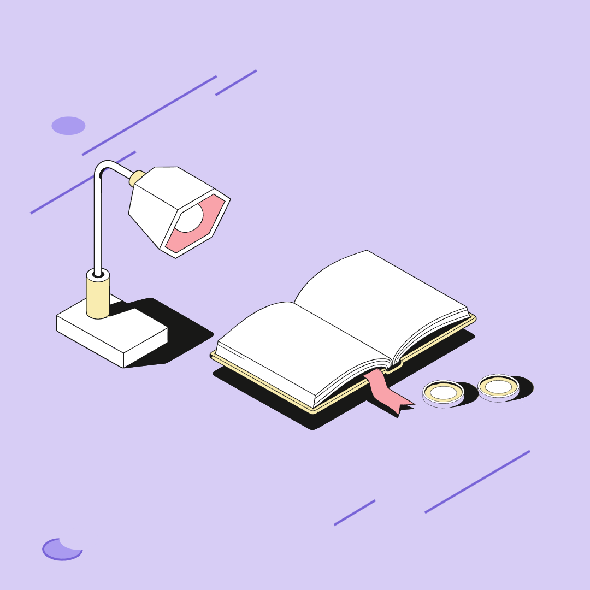

# Сочетание

Браузерный конструктор векторных иллюстраций. Он собирает сцену из исходных SVG по названиям предметов или метафоре, затем позволяет отредактировать результат на холсте.

**[Открыть конструктор](https://maxr0zen.github.io/ochen/)** · **[Примеры работ](https://maxr0zen.github.io/ochen/#examples)**



## Использование

1. Выберите «Предметы» и введите `книга, монета × 2, лампа`. Для смыслового подбора выберите «Метафора» и попробуйте `Идеи для команды`.
2. Укажите формат, детализацию S/L, состояния предметов, палитру и фон. Нажмите «Собрать композицию». «Ещё вариант» изменит расстановку.
3. Перетаскивайте предметы мышью или пальцем. Панель справа позволяет повернуть, продублировать, удалить предмет, изменить его состояние и порядок слоёв.
4. Нажмите «Скачать SVG». «Сохранить проект» выгружает JSON с текущей сценой. Его можно восстановить кнопкой «Открыть проект». Браузер также запоминает последнюю композицию локально.
5. В разделе примеров нажмите «Открыть в редакторе», чтобы изменить готовую работу. Исходник отдельного предмета доступен в панели выбранного объекта.

Стрелки перемещают выбранный предмет на 1 px, Shift + стрелки — на 10 px. Ctrl/Cmd + Z отменяет действие, Ctrl/Cmd + Shift + Z возвращает его. Ctrl/Cmd + D дублирует выбранный предмет, Delete удаляет его.

## Запуск и сборка

Нужны Node.js 22.18+ и npm.

```sh
npm ci
npm run dev
```

Локальный сайт откроется по адресу http://127.0.0.1:4175.

```sh
npm run build
```

Сборка создаёт `index.html` и `web-dist/`. Готовые примеры находятся в `examples/v3/`. Эти файлы уже включены в репозиторий.

## Бесплатный хостинг

Для GitHub Pages в настройках репозитория выберите Settings → Pages → Deploy from a branch → main → / (root). После изменения кода выполните `npm run build` и отправьте обновлённые файлы в репозиторий. Все пути относительные, поэтому сайт работает в подпапке `/ochen/`.

Для загрузки на другой статический хостинг выполните `npm run site:package`. Архив `delivery/website.zip` содержит готовую страницу, скрипт, стили и примеры. Распакованную папку можно загрузить на Netlify или другой хостинг статических файлов. Для работы сайта достаточно статической раздачи файлов.

## Архитектура

- `website/` содержит интерфейс и управление сценой. `scripts/build-site.mjs` собирает сайт через esbuild.
- `src/core.ts`, `src/composition.ts` и `src/scene-rules.ts` подбирают исходные предметы и рассчитывают композицию. Правила связывают лампу с целью, ручку с рабочей поверхностью, монеты с книгой или кошельком, телефон с наушниками.
- `library/bundle.json` хранит 40 вариантов SVG — 10 предметов × S/L × главное/фоновое состояние. `library/backdrops.json` хранит шесть исходных фонов. Варианты извлечены из исходного Figma-файла. История извлечения описана в `docs/SOURCE-AUDIT.md`.
- `src/scene-svg.ts` копирует исходные SVG в контейнеры с общим масштабом и заданными координатами. Редактор меняет положение, поворот и порядок целых предметов. Внутренние пути сохраняются.
- При экспорте сцена повторно собирается из данных и исходников. Рамка выделения и элементы интерфейса остаются в редакторе.
- В браузерную сборку включены локальный подбор, исходная библиотека и редактор. API-запросы для генерации отсутствуют. Смысловой подбор ограничен понятиями и тегами библиотеки.

Пользовательская палитра загружается в JSON по образцу `palettes/ink-mint.json`. Цвета разделены на четыре фоновые и четыре объектные роли. Фоновые предметы и декор используют фоновые цвета схемы.

## Проверки

```sh
npm run check
npm run test:site
```

Проверки сайта покрывают подбор по предметам и метафорам, фоны, перетаскивание, отмену и повтор, дублирование, слои, JSON-проекты, палитры, SVG-экспорт и адаптацию под телефон. Проверки общей логики охватывают геометрию, палитры и правила композиции.

## Плагин Figma

В `src/plugin.ts` и `dist/` сохранён предшествующий плагин. Для его сборки используйте `npm run build:plugin`, для просмотра панели — `npm run dev:plugin`. Инструкции и исторические отчёты плагина находятся в `docs/`.

## AI-инструменты разработки

Для разработки и проверки кода использовался Codex. Исходные иллюстративные предметы взяты из предоставленной библиотеки. Три сохранённых примера собраны локальным алгоритмом из этих исходников.

Логотип сайта сгенерирован встроенным imagegen. Промпт сохранён в `website/assets/logo.prompt.txt`.
